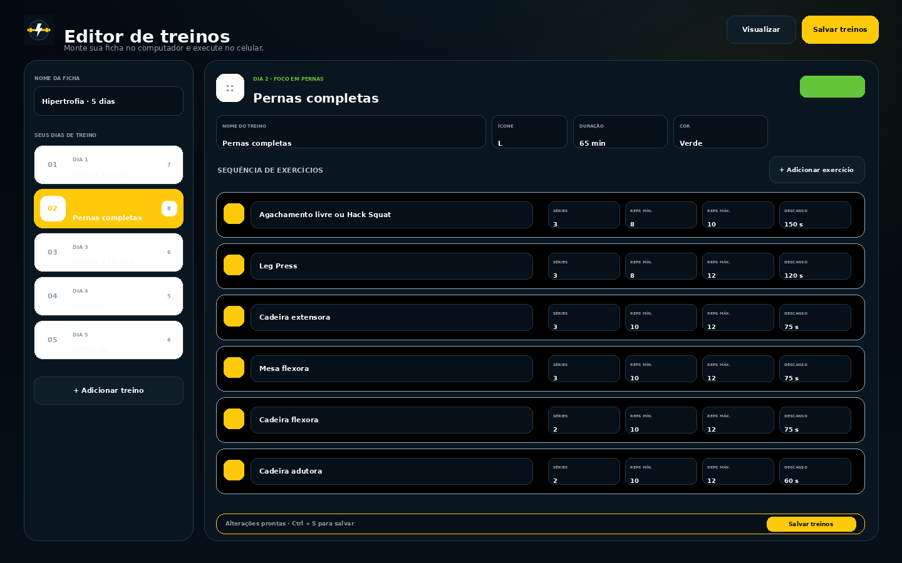
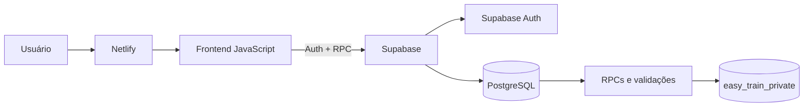

<p align="center">
  
</p>

<h1 align="center">Easy Train</h1>

<p align="center">
  Plataforma <strong>mobile-first</strong> para criar treinos, registrar evolução, treinar com amigos e participar de competições amistosas.
</p>

<p align="center">
  
  
  
  
  
</p>

<p align="center">
  <a href="#-visão-geral">Visão geral</a> •
  <a href="#-interface">Interface</a> •
  <a href="#-recursos">Recursos</a> •
  <a href="#-começando">Começando</a> •
  <a href="#-arquitetura">Arquitetura</a> •
  <a href="#-roadmap">Roadmap</a>
</p>

---

## ⚡ Visão geral

O **Easy Train** une execução de treino, acompanhamento de evolução e recursos sociais em uma experiência simples no celular. A montagem da ficha também recebe uma interface ampla para computador, permitindo organizar dias e exercícios com mais velocidade.

O projeto usa JavaScript nativo no frontend, Supabase para autenticação e persistência, e Netlify para build e hospedagem.

### Destaques

| | Recurso | O que entrega |
|---|---|---|
| 🏋️ | **Treinos próprios** | Quantidade livre de treinos, presets visuais, séries, carga e descanso. |
| ✍️ | **Editor responsivo** | Montagem rápida no PC e edição confortável no celular. |
| 📈 | **Evolução** | Histórico, volume, PRs, ofensiva, calendário e gráficos. |
| 🤝 | **Collabs** | Busca por `@usuário`, parceiros e compartilhamento de fichas. |
| 🏆 | **Competições** | Rankings por treinos, volume, PRs ou sequência. |
| 😏 | **Coach sem filtro** | Mensagens bem-humoradas quando algum grupo muscular é esquecido. |

## 📱 Interface

### Uso diário pensado para mobile

<p align="center">
  
</p>

### Montagem prática no computador

<p align="center">
  
</p>

### Collabs e competições

<p align="center">
  
</p>

> As imagens usam dados ilustrativos para apresentar a experiência do produto.

## 🚀 Recursos

### Durante o treino

- sequência de exercícios por dia;
- registro de peso e repetições em cada série;
- cronômetro total e individual;
- descanso automático e ajustável;
- pausa e retomada da sessão;
- anotações por exercício;
- aviso de novo recorde pessoal;
- resumo final com volume, duração, séries e avaliação.

### Organização e evolução

- fichas com qualquer quantidade de treinos e meta semanal configurável;
- rotina flexível, sem obrigar segunda a sexta;
- presets de pernas, peito, costas, braços, ombros, core, cardio e full body;
- biblioteca de emojis e foco muscular por treino;
- validade opcional ou ficha sem data final;
- histórico detalhado de sessões;
- gráfico de evolução por exercício;
- recordes pessoais;
- ofensiva e calendário de frequência;
- comparação de volume entre sessões.

### Social

- contas individuais;
- perfil público opcional;
- busca por nome ou `@usuário`;
- solicitações de collab;
- compartilhamento e importação de fichas;
- competições privadas por código ou convite;
- rankings recalculados pelo banco.

## 🧰 Stack

| Camada | Tecnologia |
|---|---|
| Interface | HTML, CSS e JavaScript com ES Modules |
| Autenticação | Supabase Auth |
| Banco | PostgreSQL no Supabase |
| API | RPCs PostgreSQL controladas |
| Hospedagem | Netlify |
| Aplicativo | PWA online, sem persistência offline dos dados |
| Experiência | Tema do sistema por padrão, modos claro/escuro, login persistente opcional e instalação guiada |
| Qualidade | Node Test Runner, QA próprio, GitHub Actions e CodeQL |

## 🏁 Começando

### Requisitos

- Node.js 22 ou superior;
- um projeto Supabase de desenvolvimento;
- Git.

### 1. Clone e configure

```bash
git clone URL_DO_SEU_REPOSITORIO
cd easy-train
cp .env.example .env
```

Preencha o `.env`:

```env
SUPABASE_URL=https://seu-projeto.supabase.co
SUPABASE_PUBLISHABLE_KEY=sb_publishable_...
```

Nunca coloque `service_role`, senha do banco ou segredo SMTP no frontend.

### 2. Instale o banco

No SQL Editor do Supabase, rode:

```text
supabase/INSTALL_ALL.sql
supabase/VERIFY.sql
```

Os arquivos-fonte do banco ficam em `supabase/parts/`. Após alterar uma parte:

```bash
npm run sql:build
npm run sql:check
```

### 3. Execute localmente

```bash
npm run dev
```

Abra `http://localhost:5173`.

### 4. Valide antes de enviar

```bash
npm run qa
```

## 🏗️ Arquitetura



O navegador não recebe acesso direto às tabelas internas. O cliente chama RPCs públicas controladas, enquanto os dados permanecem no schema privado `easy_train_private` com RLS e permissões restritas.

Mais detalhes em [`docs/ARCHITECTURE.md`](docs/ARCHITECTURE.md).

## 🔐 Segurança

- autenticação individual pelo Supabase Auth;
- tabelas internas sem acesso direto do cliente;
- RLS em todas as tabelas;
- RPCs `security definer` com `search_path` fixado;
- validação e limites de payload no PostgreSQL;
- estatísticas recalculadas no banco;
- controle otimista de revisão entre dispositivos;
- CSP, HSTS, `nosniff` e bloqueio de iframe no Netlify;
- CI procurando configuração real e inconsistências básicas.

Leia [`SECURITY.md`](SECURITY.md) antes de relatar vulnerabilidades.

## ☁️ Deploy

O Netlify executa `npm run build` e gera `dist/config.js` usando:

```text
SUPABASE_URL
SUPABASE_PUBLISHABLE_KEY
```

O guia completo está em [`docs/DEPLOYMENT.md`](docs/DEPLOYMENT.md). Antes de uma versão pública, use também o [`checklist de release`](docs/RELEASE_CHECKLIST.md).

## 🧪 Qualidade

```bash
npm run qa
```

Esse comando valida:

- sintaxe e estrutura do frontend;
- testes automatizados;
- consistência do SQL consolidado;
- proteção contra configuração real versionada;
- build, PWA, ícones e screenshots;
- cabeçalhos e regras do Netlify.

O relatório atual está em [`docs/QA_REPORT.md`](docs/QA_REPORT.md).

## 🗺️ Roadmap

- notificações e lembretes configuráveis;
- biblioteca comunitária de fichas;
- bloqueio e moderação de usuários;
- painel administrativo básico;
- migrações incrementais versionadas;
- testes end-to-end com Supabase local;
- internacionalização;
- melhorias de acessibilidade e desempenho.

Acompanhe os detalhes em [`docs/ROADMAP.md`](docs/ROADMAP.md).

## 🤝 Contribuindo

Contribuições são bem-vindas. Leia:

- [`CONTRIBUTING.md`](CONTRIBUTING.md);
- [`CODE_OF_CONDUCT.md`](CODE_OF_CONDUCT.md);
- [`docs/GITHUB_SETUP.md`](docs/GITHUB_SETUP.md).

Toda alteração deve passar por:

```bash
npm run qa
```

## 📄 Licença

Distribuído sob a licença MIT. Consulte [`LICENSE`](LICENSE).
